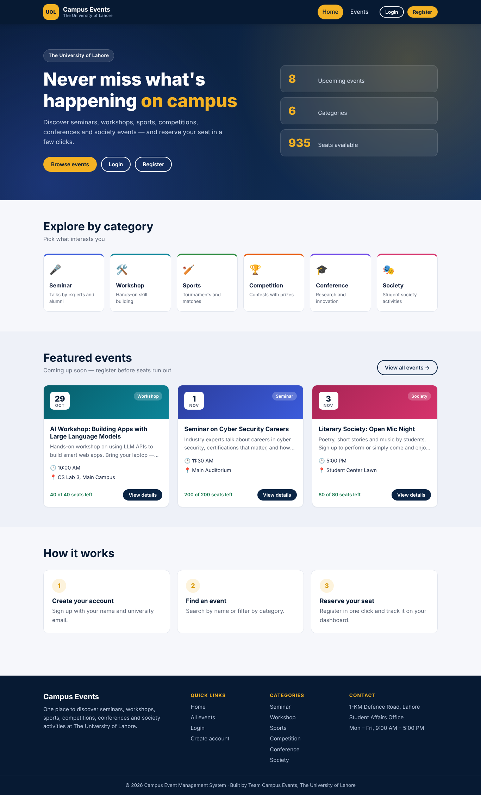
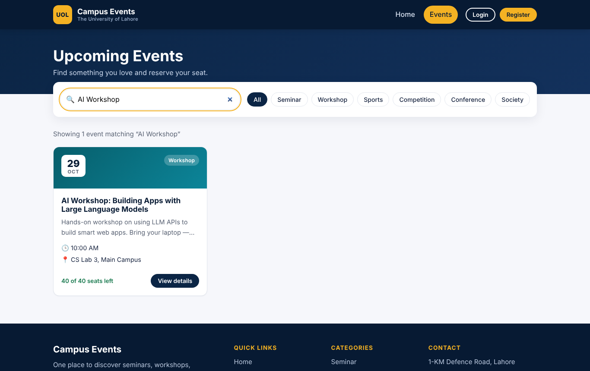
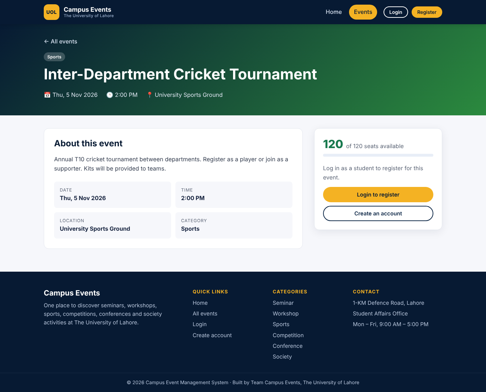
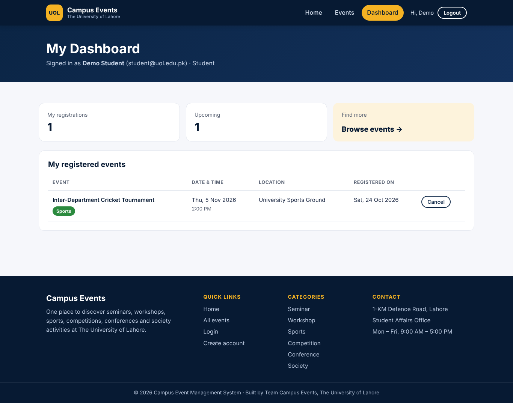
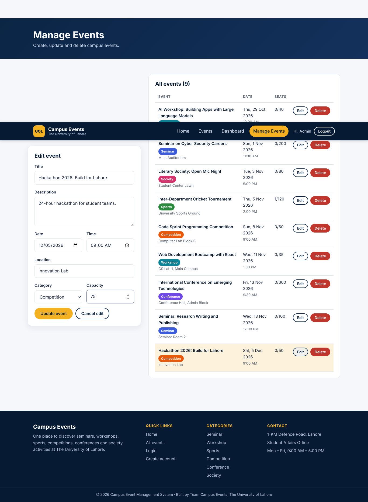

# 🎓 Campus Event Management System

A full-stack web application where students of **The University of Lahore** can browse university events — seminars, workshops, sports, competitions, conferences and society activities — and register for them. Administrators can create, update and delete events.



## 👥 Team Members

| Role | Name | Branch |
|---|---|---|
| Team Lead / Project Manager | **Qursam Bibi** (70179225) | `main`, `feature/integration` |
| Front-End Developer 1 (UI) | **Muzammil Hussain** (70177133) | `feature/frontend-ui` |
| Front-End Developer 2 (Functionality) | **Fatima Umer** (70177175) | `feature/frontend-functionality` |
| Back-End Developer 1 (REST API) | **Maria Munawer** | `feature/backend-api` |
| Back-End Developer 2 (Database & Testing) | **Aqsa Maratab** | `feature/database-testing` |

## ✨ Features

- **Home page** — university name, navigation, featured events, login/register buttons
- **Event listing** — event cards with date, time, location, category and available seats
- **Search** events by title, description or location (e.g. "AI Workshop")
- **Filter** by category: Seminar, Workshop, Sports, Competition, Conference, Society
- **Event details** page with a student registration form and live seat counter
- **Sign up / Login** with form validation and JWT authentication
- **Dashboard** — students see and cancel their registrations; admins see all registrations
- **Admin event management** — create, update and delete events
- **Role-based access** (student / admin), protected routes
- **Responsive design** for mobile, tablet and desktop
- **Automated tests** (32 API + database tests) and a **Postman collection**
- **GitHub Actions CI** runs tests and the frontend build on every pull request

## 🛠️ Technologies

| Layer | Technology |
|---|---|
| Front end | React 18, Vite, React Router, CSS3 |
| Back end | Node.js, Express.js, REST API |
| Database | SQLite (better-sqlite3) |
| Auth | JWT (jsonwebtoken), bcrypt password hashing |
| Testing | Node test runner, Supertest, Postman |
| Collaboration | Git, GitHub (Issues, Branches, Pull Requests, Code Review), GitHub Actions |
| Deployment | Render (backend), Vercel (frontend) |

## 🏗️ Architecture

```
┌──────────────────────┐   fetch() + JWT    ┌──────────────────────┐   SQL    ┌───────────┐
│  React front end     │ ─────────────────▶ │  Express REST API    │ ───────▶ │  SQLite   │
│  (Vite, port 5173)   │ ◀───── JSON ────── │  (Node, port 5000)   │ ◀─────── │  database │
└──────────────────────┘                    └──────────────────────┘          └───────────┘
 pages · components ·                         routes → controllers →
 services/api.js · AuthContext                models → database/db.js
```

More detail: [`documentation/ARCHITECTURE.md`](documentation/ARCHITECTURE.md)

## 📁 Project Structure

```
campus-event-management/
├── frontend/
│   ├── src/
│   │   ├── components/   # Navbar, Footer, EventCard, SearchFilter, ProtectedRoute
│   │   ├── pages/        # Home, Events, EventDetails, Login, Signup, Dashboard, AdminEvents
│   │   ├── services/     # api.js — all backend calls
│   │   ├── context/      # AuthContext — login state
│   │   ├── styles/       # CSS per feature
│   │   └── utils/        # validation + date formatting
│   └── README.md
├── backend/
│   ├── routes/           # URL definitions
│   ├── controllers/      # request handling
│   ├── models/           # SQL queries
│   ├── middleware/       # auth, validation, error handling
│   ├── database/         # schema.sql, db.js, seed.js
│   ├── tests/            # automated tests
│   └── README.md
├── documentation/        # API, database, testing, architecture, GitHub workflow, Postman
├── screenshots/
├── .github/              # CI workflow, PR + issue templates
├── README.md
├── .gitignore
└── LICENSE
```

## 🚀 Installation

**Requirements:** [Node.js 18+](https://nodejs.org/) and Git.

```bash
git clone https://github.com/QURSAM-70179225/campus-event-management.git
cd campus-event-management
```

### 1. Back end (terminal 1)

```bash
cd backend
npm install
cp .env.example .env        # Windows: copy .env.example .env
npm run dev                 # → http://localhost:5000
```

The SQLite database is created and filled with sample events automatically.

### 2. Front end (terminal 2)

```bash
cd frontend
npm install
cp .env.example .env        # Windows: copy .env.example .env
npm run dev                 # → http://localhost:5173
```

### Demo accounts

| Role | Email | Password |
|---|---|---|
| Admin | admin@uol.edu.pk | admin123 |
| Student | student@uol.edu.pk | student123 |

### Run the tests

```bash
cd backend
npm test
```

## 🔌 API Overview

| Method | Endpoint | Access |
|---|---|---|
| GET | `/api/events` (`?search=&category=`) | Public |
| GET | `/api/events/:id` | Public |
| POST | `/api/events` | Admin |
| PUT | `/api/events/:id` | Admin |
| DELETE | `/api/events/:id` | Admin |
| POST | `/api/register` | Logged in |
| GET | `/api/registrations` | Logged in |
| DELETE | `/api/registrations/:id` | Owner / Admin |
| POST | `/api/signup` | Public |
| POST | `/api/login` | Public |

Full reference with request/response examples: [`documentation/API.md`](documentation/API.md) · Database design: [`documentation/DATABASE.md`](documentation/DATABASE.md)

## 🌐 Deployment

**Back end → Render**
1. Render dashboard → **New → Blueprint** → choose this repository (uses `render.yaml`).
2. After deploy, copy the API URL, e.g. `https://campus-event-api.onrender.com`.

**Front end → Vercel**
1. Vercel → **Add New Project** → import this repository → set **Root Directory** to `frontend`.
2. Add environment variable `VITE_API_URL` = your Render API URL → Deploy.
3. Back in Render, set `CLIENT_URL` to your Vercel URL.

> Render's free plan does not keep files between restarts, so the SQLite data resets to the sample events after a restart. That is fine for a demo; for permanent data use a paid disk or a hosted database.

## 🤝 GitHub Workflow

`main` always holds the stable version. Every member works on their own feature branch, opens a Pull Request, and the Team Lead reviews and merges it. Details, labels and the issue list: [`documentation/GITHUB-WORKFLOW.md`](documentation/GITHUB-WORKFLOW.md)

## 📸 Screenshots

| Events + search | Event details |
|---|---|
|  |  |
| **Student dashboard** | **Admin — manage events** |
|  |  |

More in [`screenshots/`](screenshots/).

## 📄 License

[MIT](LICENSE)
