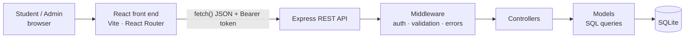

# Architecture

## Overview

The system is a classic three-tier web application.

## Front end (`frontend/`)

| Folder | Responsibility | Owner |
|---|---|---|
| `components/` | Navbar, Footer, EventCard (UI) | Muzammil |
| `components/SearchFilter.jsx` | Search box + category chips | Fatima |
| `components/ProtectedRoute.jsx` | Blocks pages for guests / non-admins | Qursam |
| `pages/` Home, Events | Main UI | Muzammil |
| `pages/` EventDetails, Login, Signup, Dashboard | Interactive pages | Fatima |
| `pages/AdminEventsPage.jsx` | Create / update / delete events | Qursam |
| `services/api.js` | Single place for every backend call; adds the JWT | Fatima |
| `context/AuthContext.jsx` | Stores the logged-in user + token | Fatima |

**Login flow:** `LoginPage` → `AuthContext.login()` → `POST /api/login` → token saved in `localStorage` → every later request sends `Authorization: Bearer <token>`.

## Back end (`backend/`)

Request path: `routes/` → `middleware/` → `controllers/` → `models/` → `database/db.js`

| Layer | Files | Owner |
|---|---|---|
| Server | `server.js`, `app.js` | Maria |
| Routes | `routes/*.js` | Maria |
| Controllers | `controllers/*.js` | Maria |
| Auth middleware | `middleware/auth.js` (JWT + admin check) | Maria |
| Validation + errors | `middleware/validate.js`, `middleware/errorHandler.js` | Aqsa |
| Models | `models/*.js` | Aqsa |
| Database | `database/schema.sql`, `db.js`, `seed.js` | Aqsa |
| Tests | `tests/*.test.js`, Postman collection | Aqsa |

## Security decisions

- Passwords are hashed with **bcrypt**; the hash is never returned by the API.
- **JWT** tokens expire after 7 days; the secret comes from `.env`.
- Sign-up always creates a **student**; admins only come from the seed script.
- Every write route validates input on the server, even though the front end also validates.
- SQL uses **prepared statements** (no string concatenation) to prevent SQL injection.
- Database rules (UNIQUE, CHECK, FOREIGN KEY) protect data even if a bug skips validation.
