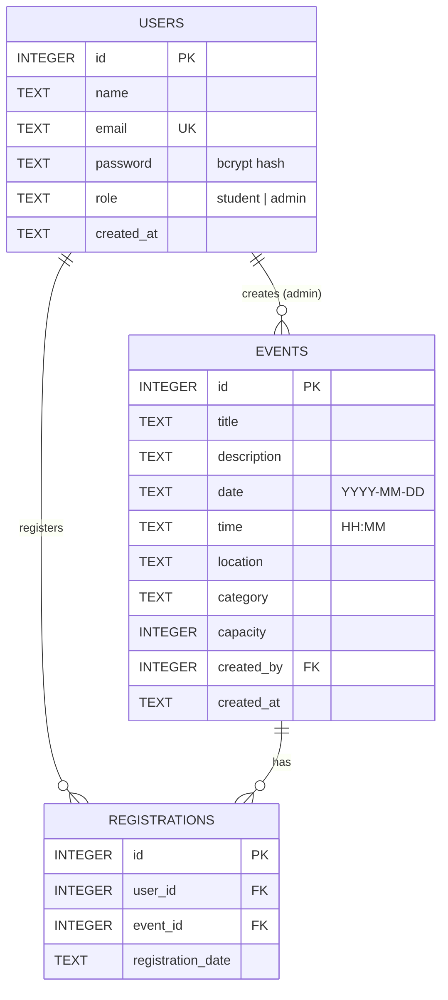

# Database Documentation

**Engine:** SQLite (file `backend/database/campus_events.db`, created automatically on first run)
**Driver:** [better-sqlite3](https://github.com/WiseLibs/better-sqlite3)
**Schema file:** `backend/database/schema.sql`

## Entity Relationship Diagram



## Tables

### users

| Column | Type | Rules |
|---|---|---|
| id | INTEGER | Primary key, auto-increment |
| name | TEXT | Required |
| email | TEXT | Required, **unique** |
| password | TEXT | bcrypt hash (plain passwords are never stored) |
| role | TEXT | `student` (default) or `admin` |
| created_at | TEXT | Defaults to current timestamp |

### events

| Column | Type | Rules |
|---|---|---|
| id | INTEGER | Primary key |
| title | TEXT | Required |
| description | TEXT | Required |
| date | TEXT | `YYYY-MM-DD` |
| time | TEXT | `HH:MM` |
| location | TEXT | Required |
| category | TEXT | CHECK: Seminar, Workshop, Sports, Competition, Conference, Society |
| capacity | INTEGER | CHECK: > 0 |
| created_by | INTEGER | FK → users.id (`ON DELETE SET NULL`) |
| created_at | TEXT | Defaults to current timestamp |

### registrations

| Column | Type | Rules |
|---|---|---|
| id | INTEGER | Primary key |
| user_id | INTEGER | FK → users.id (`ON DELETE CASCADE`) |
| event_id | INTEGER | FK → events.id (`ON DELETE CASCADE`) |
| registration_date | TEXT | Defaults to current timestamp |

`UNIQUE(user_id, event_id)` stops a student from registering twice for the same event.

## Seats available

Seats are never stored; they are calculated in every event query so they can't go out of sync:

```sql
SELECT e.*, COUNT(r.id) AS registered, e.capacity - COUNT(r.id) AS seats_available
FROM events e
LEFT JOIN registrations r ON r.event_id = e.id
GROUP BY e.id;
```

## Seed data

`npm run seed` adds (only when the database is empty):

| Role | Email | Password |
|---|---|---|
| Admin | admin@uol.edu.pk | admin123 |
| Student | student@uol.edu.pk | student123 |

…plus 8 sample events across all categories. `npm run seed -- --reset` clears everything and seeds again. The server also seeds automatically on its first start.

## CRUD verification

`backend/tests/database.test.js` checks INSERT, SELECT, UPDATE and DELETE on every table, plus the UNIQUE, CHECK and CASCADE rules, using an in-memory database. Run with `npm test`.

To inspect the real database by hand, open `backend/database/campus_events.db` in [DB Browser for SQLite](https://sqlitebrowser.org/).
